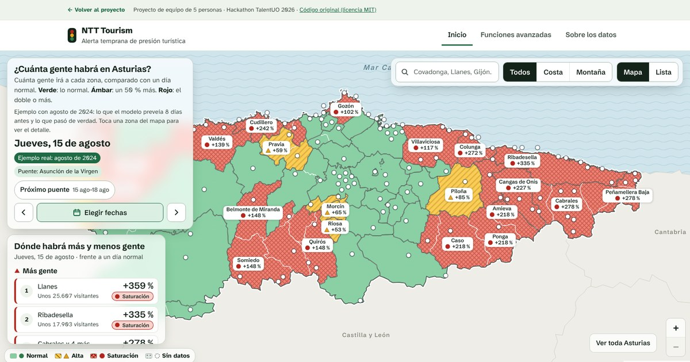

# NTT Tourism · Avisar de los días de lleno en Asturias

**[Ver la demo](https://adrian-fzl-data.github.io/ntt-tourism/)** · Proyecto de equipo de 5 personas · Hackathon TalentUO 2026 (Universidad de Oviedo) · [Código original del equipo](https://github.com/TalentUO/TalentUO)



Un modelo que prevé, para cada día y cada una de las 46 zonas de movilidad de Asturias (78 concejos), cuánta gente llegará de ocio comparado con un día normal. Una web lo enseña como un semáforo: verde, lo normal; ámbar, un 50 % más; rojo, el doble o más. Está pensado para ayuntamientos, el Principado y el Parque Nacional de los Picos de Europa.

Este repositorio es una **versión de escaparate**: la web del equipo congelada en agosto de 2024, con datos reales, para comparar lo que el modelo preveía con lo que pasó de verdad.

## Cifras

| | |
|---|---|
| **9,7 %** | error medio en visitantes a 1–7 días, frente al 12,9 % de suponer un día normal |
| **+227 % / +290 %** | previsto 8 días antes y real en Cangas de Onís y los Lagos el 15 de agosto de 2024 |
| **46 zonas** | los 78 concejos de Asturias, con un semáforo cada día |

Validación fuera de muestra, por bloques de tiempo que el modelo no vio al entrenar.

## Cómo funciona

- **Datos:** viajes diarios del MITMA (2022–2025) y factores que se conocen de antemano: festivos, puentes, vacaciones escolares, eventos, previsión del tiempo e interés en internet.
- **Modelo:** XGBoost en Python, uno global para todas las zonas, con un modelo a corto plazo (1–7 días) y otro a largo plazo. Una regla anti-fuga impide usar nada que no se supiera el día de la previsión.
- **Web:** HTML, CSS y JavaScript sin framework, con Leaflet. Funciona sin conexión y desde el propio fichero.

## Mi papel

Somos un equipo de 5. Me encargué de los datos de demanda y movilidad (MITMA, INE y SADEI), apoyé el diseño de la web y la explicación de los datos, y preparé el repositorio para hacerlo público: licencias de los datos de terceros, integración continua y documentación. Cocreé el repositorio del equipo.

## Lo que todavía no hace

Aún se le escapan bastantes días de saturación. Y los datos de movilidad no se publican en tiempo real, así que la demo enseña agosto de 2024.

## Abrirla en local

```bash
python3 -m http.server 8000     # desde la raíz del repositorio
# y abrir http://127.0.0.1:8000/
```

`demo/index.html` también se abre con doble clic. El vídeo de la demo se genera con los scripts de [`video/`](video/LEEME.md).

## Créditos y licencia

Código del equipo NTT Tourism (Hackathon TalentUO 2026), con licencia MIT: ver [LICENSE](LICENSE) y el [repositorio original](https://github.com/TalentUO/TalentUO). El contorno de las provincias vecinas sale de es-atlas ([licencia](herramientas/LICENCIA-es-atlas.txt)). «NTT Tourism» es el nombre del proyecto del equipo, no un producto de NTT DATA.

---

*In English:* NTT Tourism forecasts, day by day and zone by zone, how many leisure visitors will reach Asturias compared with a normal day, and shows it as a traffic light. A team project of five people built at the TalentUO 2026 Hackathon (University of Oviedo); I worked on the demand and mobility data (MITMA, INE, SADEI). The demo replays August 2024 with real data: 9.7 % mean error at 1–7 days, against 12.9 % for assuming a normal day.
